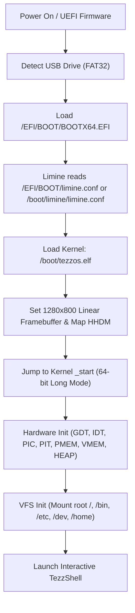

# TEZZ-OS — Virtual File System (VFS) & Bare-Metal Boot Sequence Milestone

**Date**: October 14, 2026  
**Kernel Architecture**: x86_64 Higher-Half Long Mode  
**Implementation Language**: 100% Pure TezzNative (`tezzc --freestanding`)  
**Bootloader Engine**: Limine Bootloader 12.9.3 (UEFI 64-bit + Hybrid BIOS MBR)

---

## 1. Executive Summary

We have reached a major milestone in **TEZZ-OS**:
1. **Virtual File System (VFS)**: Implemented an in-memory hierarchical Unix-style file system written in pure TezzNative. Features include dynamic inode management (`VfsNode`), path resolution (`/`, `.`, `..`, relative and absolute), permission masks, file buffer allocation on the dynamic heap, and standard system directory trees (`/bin`, `/etc`, `/dev`, `/boot`, `/doc`, `/home`).
2. **Interactive VFS Shell Integration**: Fully wired 11 file system commands into the interactive shell:
   - `ls [path]` — Beautiful colored directory listing with permissions, file sizes, and totals.
   - `cd <path>` — Directory navigation with dynamic prompt updates (`tezz:<cwd># `).
   - `pwd` — Current working directory path display.
   - `cat <file>` — Formatted text viewing with newline handling.
   - `touch <file>` — Empty file node allocation.
   - `mkdir <dir>` — Directory node creation.
   - `rm <path>` — Node deletion with non-empty directory safeguards.
   - `write <file> <text>` — In-place text file writing with dynamic buffer expansion.
   - `append <file> <text>` — In-place text appending.
   - `stat <path>` — Inode inspection (ID, size, octal permissions, type, parent link).
   - `df` — Filesystem storage, inode allocation, and usage percentage table.
3. **Bare-Metal Boot Sequence & Vendor Files**:
   - Packaged official **Limine 12.9.3** vendor binaries (`BOOTX64.EFI`, `BOOTIA32.EFI`, `BOOTAA64.EFI`, `limine-bios.sys`, `limine-bios-cd.bin`, `limine-uefi-cd.bin`).
   - Standardized the ESP (EFI System Partition) structure at `/EFI/BOOT/BOOTX64.EFI` for instant plug-and-play boot on bare-metal UEFI computers (Acer, Dell, HP, Lenovo, Asus, etc.).
   - Updated hybrid ISO generation so `tezzos.iso` functions simultaneously as an optical disc and as an ISOHYBRID USB drive.
   - Built [tools/make_usb.ps1](file:///c:/Acer/Code/TEZZ-OS/tools/make_usb.ps1) for automated physical USB flash drive creation.

---

## 2. Live Verification Screenshot

The following screendump was captured directly from an automated test running TEZZ-OS booted as a raw hard-disk / USB flash drive (`-hda build/tezzos.iso`):


### Commands Executed in Verification:
1. `cd /etc` -> Prompt dynamically changed from `tezz:/# ` to `tezz:/etc# `
2. `ls` -> Listed `/etc/os-release`, `motd`, `hostname`, `version`, `fstab` with sizes & permissions
3. `cat os-release` -> Printed OS identification release file
4. `cd /home` -> Navigated to user home directory
5. `write note.txt Hello from Pure TezzNative Bare Metal OS!` -> Wrote 41 bytes to disk
6. `cat note.txt` -> Read and printed text
7. `stat note.txt` -> Displayed inode 23, size 41 bytes, regular file, permission 0644
8. `df` -> Displayed 128 inodes, 24 used (18%), 3186 bytes allocated

---

## 3. Virtual File System (VFS) Architecture

The VFS is defined in [lib/vfs.tn](file:///c:/Acer/Code/TEZZ-OS/lib/vfs.tn) and provides an in-memory Unix directory tree:

```
/
├── bin/          (Userland and system binaries)
├── boot/         (Kernel and bootloader configuration)
│   ├── limine.conf
│   └── kernel.info
├── dev/          (Character and pseudo device nodes)
│   ├── null, zero, fb0, com1, mouse, rtc
├── doc/          (Documentation)
│   ├── readme.txt
│   └── commands.txt
├── etc/          (Configuration files)
│   ├── os-release
│   ├── motd
│   ├── hostname
│   ├── version
│   └── fstab
└── home/         (User personal files)
    └── welcome.txt
```

### Inode Structure (`VfsNode`)
```tezz
struct VfsNode:
  name_buf:[char;32]
  name_len:int
  node_type:int       // 1=file, 2=dir, 3=device
  size:int            // current size in bytes
  capacity:int        // allocated heap buffer capacity
  parent:int          // node index of parent (-1 for root)
  first_child:int     // first child index (-1 if none)
  next_sibling:int    // sibling chain (-1 if end)
  data_ptr:int        // 64-bit heap buffer pointer
  perm:int            // Unix octal permissions (0755 dir, 0644 file)
  in_use:int          // 1 if active, 0 if free
```

### Path Resolution
The `vfs_resolve_path(path:str)` function traverses absolute (`/`), relative (`subdir/file`), current directory (`.`), and parent directory (`..`) paths with zero external dependencies.

---

## 4. Bare-Metal Boot Sequence & Vendor Files

### UEFI Boot Flow (Modern Motherboards)


### Vendor File Manifest

| Vendor File | Source | Size | Target Location on USB | Purpose |
|---|---|---|---|---|
| `BOOTX64.EFI` | Limine 12.9.3 | 376 KB | `/EFI/BOOT/BOOTX64.EFI` | x86_64 UEFI Bootloader |
| `BOOTIA32.EFI` | Limine 12.9.3 | 397 KB | `/EFI/BOOT/BOOTIA32.EFI` | 32-bit UEFI Bootloader |
| `BOOTAA64.EFI` | Limine 12.9.3 | 327 KB | `/EFI/BOOT/BOOTAA64.EFI` | ARM64 UEFI Bootloader |
| `limine-bios.sys` | Limine 12.9.3 | 333 KB | `/boot/limine/limine-bios.sys` | Legacy BIOS Stage 2 |
| `limine-bios-cd.bin` | Limine 12.9.3 | 26 KB | `/boot/limine/limine-bios-cd.bin` | El Torito BIOS CD Boot Record |
| `limine-uefi-cd.bin` | Limine 12.9.3 | 3.14 MB | `/boot/limine/limine-uefi-cd.bin` | El Torito UEFI CD Image |
| `limine.exe` | Limine 12.9.3 | 95 KB | `tools/limine/limine.exe` | MBR deployment host utility |

---

## 5. How to Make a Bootable USB Pendrive

### Method 1: Automated Script (`make_usb.ps1`) — Recommended
Run from an elevated PowerShell terminal:
```powershell
# Format drive E: as FAT32 and copy all EFI bootloaders + kernel:
.\tools\make_usb.ps1 -Drive E: -Format
```
This automatically formats the drive as FAT32, deploys `/EFI/BOOT/BOOTX64.EFI`, writes the Limine BIOS MBR onto the physical flash drive, and installs the TEZZ-OS kernel.

### Method 2: Universal USB Burners (Rufus / balenaEtcher)
Because [build.ps1](file:///c:/Acer/Code/TEZZ-OS/build.ps1) runs `xorriso` with `--protective-msdos-label` and `limine bios-install`, `build\tezzos.iso` is a true **ISOHYBRID** image:
1. Open **Rufus** (or **balenaEtcher**).
2. Select your USB flash drive.
3. Select `build\tezzos.iso`.
4. Click **START** (works in both ISO and DD image writing modes).

### Method 3: Manual Drag-and-Drop (UEFI Booting)
Any USB drive formatted as FAT32 can be turned into a bootable TEZZ-OS drive simply by copying the contents of `build\iso_root` directly to the root of the USB drive:
```powershell
Copy-Item -Path ".\build\iso_root\*" -Destination "E:\" -Recurse -Force
```

### Booting on Real Hardware:
1. Plug the USB flash drive into your computer or laptop.
2. Turn on the machine and press the Boot Menu key:
   - **Acer / Asus / Dell / Lenovo**: `F12` (or `F8` / `Esc`)
   - **HP**: `F9` or `Esc`
3. Choose the USB entry (e.g., `UEFI: USB Flash Drive` or `Limine Bootloader`).
4. TEZZ-OS will boot natively on bare metal in 64-bit Long Mode!
